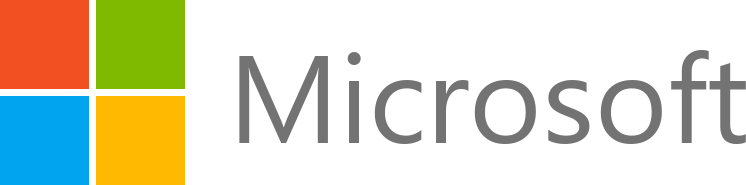
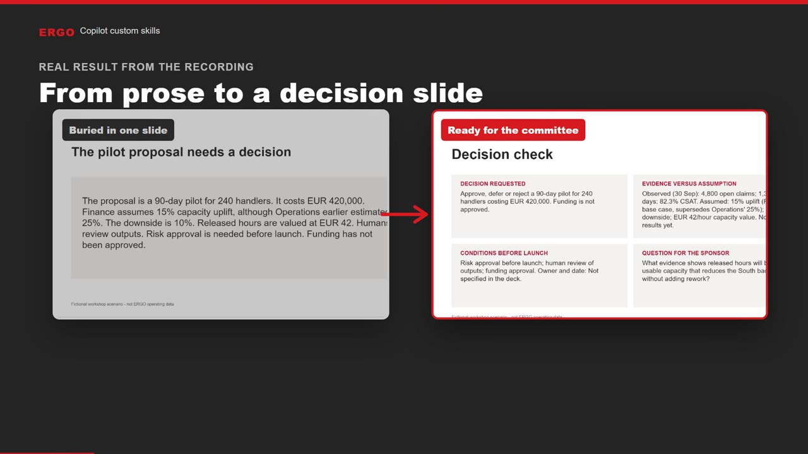
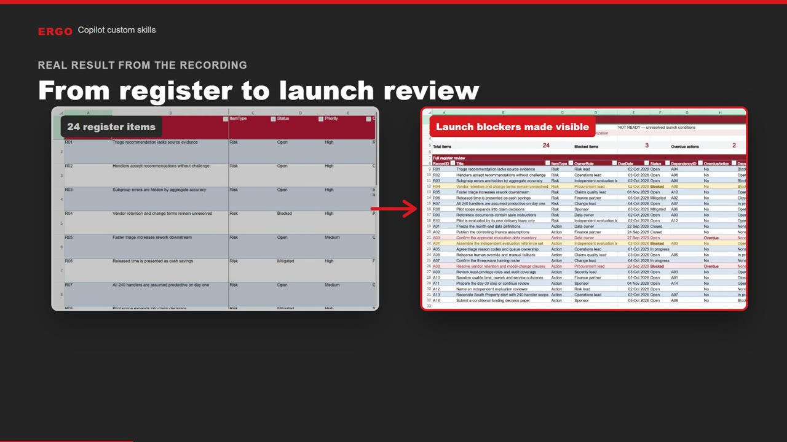

---
hide:
  - toc
---

# ERGO × Microsoft Female Leadership Workshop

  
  ×
  

Welcome! In this hands-on session you will use **Microsoft 365 Copilot custom skills**. A skill is a short set of instructions that tells Copilot how your team does a recurring task. Once the skill is added, you simply ask in plain language and Copilot applies your method.

There are two labs. Pick one to start with; each takes about 15 minutes.

  <a class="path" href="labs/p1-powerpoint/">
    
    P1PowerPoint
    <h3>Prepare a committee decision check</h3>
    
Turn a dense proposal slide into one clear decision slide for the committee.

    This way to PowerPoint →
  </a>
  <a class="path" href="labs/x1-excel/">
    
    X1Excel
    <h3>Find launch blockers in a register</h3>
    
Turn a 24-item pilot register into a formula-based launch review.

    This way to Excel →
  </a>

## What you will practise

- [x] Add a custom skill and read what it tells Copilot to do
- [x] Ask for the task normally, without naming the skill
- [x] Check that the result matches what you expected
- [x] Decide what still needs human judgement

## Before you start

!!! info "You need"
    - Microsoft 365 Copilot in **PowerPoint or Excel for the web**
    - The practice file and skill package, downloadable inside each lab
    - Permission to edit the file you open

!!! note "Workshop data"
    All numbers, names and records are fictional and were created for this workshop. They are not ERGO operating data.
