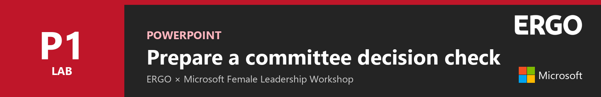
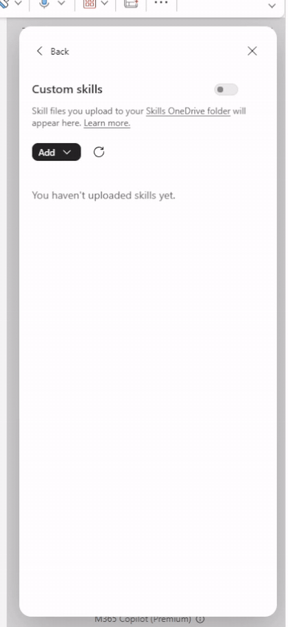
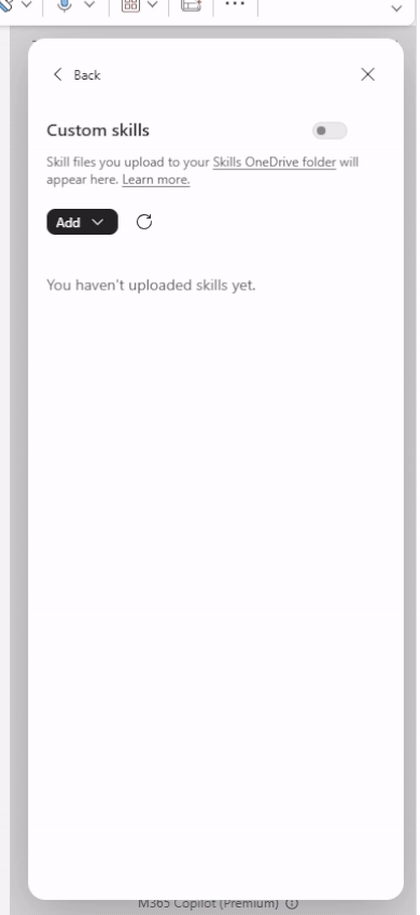
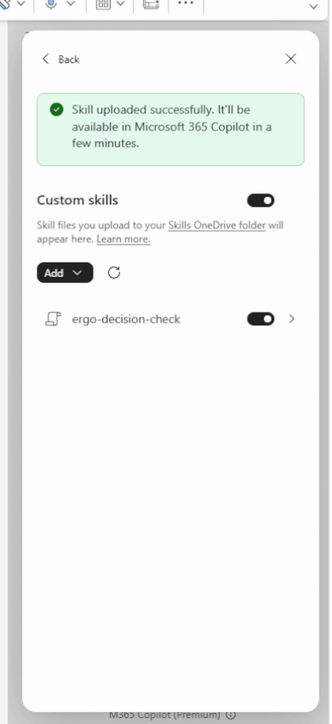
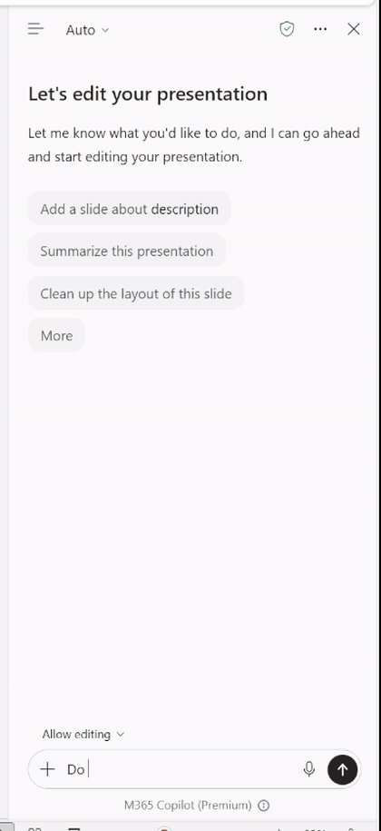
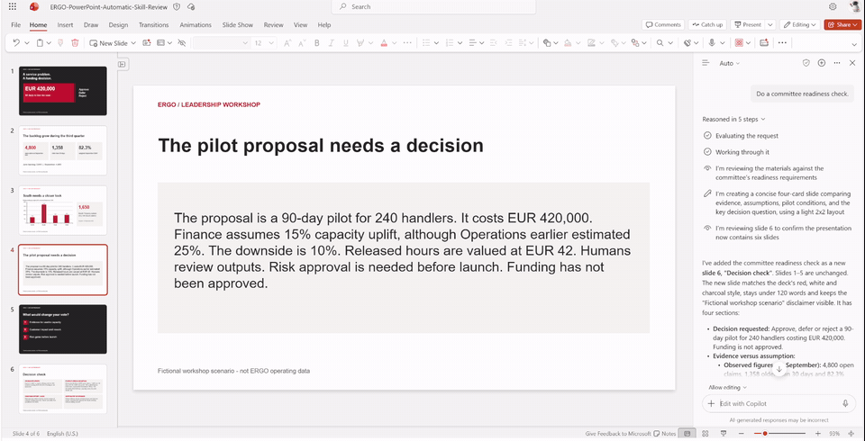
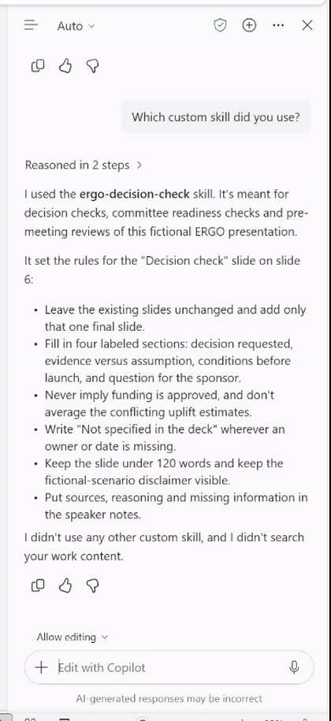

# Lab P1 - Prepare a committee decision check



In this lab you will add a custom skill to Copilot in PowerPoint. Then you will ask for a committee readiness check in plain language. Copilot will add one clear final slide to a fictional proposal deck, without changing the original slides.

In this lab you will learn:

- Where custom skills live in Copilot in PowerPoint
- How to upload a skill and read what it tells Copilot to do
- How to ask for the task without naming the skill
- How to check the result before you rely on it

## Introduction

Watch this short video first. It shows the whole lab from start to finish, using the real PowerPoint run. The video has on-screen captions and no sound.

<video controls muted playsinline preload="metadata" poster="../../assets/images/powerpoint-poster.jpg">
  <source src="../../assets/video/powerpoint-intro.mp4" type="video/mp4">
</video>

!!! info "Lab files"
    - [ERGO-Skill-Decision-Before.pptx](../assets/downloads/ERGO-Skill-Decision-Before.pptx){ download } - five-slide practice deck
    - [ergo-decision-check.zip](../assets/downloads/ergo-decision-check.zip){ download } - the custom skill. Keep it zipped; PowerPoint reads the ZIP directly.

## Exercise 1: Add the skill

### Step 1: Open the practice deck

Upload **ERGO-Skill-Decision-Before.pptx** to your OneDrive and open it in PowerPoint for the web. Select **Copilot** on the ribbon to open the Copilot pane.

!!! tip "Read-only?"
    If PowerPoint opens the file read-only or shows a repair banner, select **Save a copy** and continue in the copy.

### Step 2: Open Custom skills

In the Copilot pane, select **…** (Settings and more), then **Manage plugins & skills**, then **Custom skills**. Select **Add**.

You will see four options: **Create manually**, **Upload**, **Record a skill** and **Add in OneDrive**.

<figure class="narrow" markdown>

</figure>

### Step 3: Upload the skill

Select **Upload** and choose **ergo-decision-check.zip**. Wait until **ergo-decision-check** appears in the list. Make sure both **Custom skills** and **ergo-decision-check** are switched on.

<figure class="narrow" markdown>

</figure>

### Step 4: Read what the skill tells Copilot

Select the skill name to open it. A skill has two parts:

- **Description:** when Copilot should use it. Here: *decision checks, committee readiness checks or pre-meeting reviews*.
- **Instructions:** what Copilot must do. Here: add one *Decision check* slide with four sections, and never imply that funding is approved.

<figure class="narrow" markdown>

</figure>

Close the skill panel when you are done.

## Exercise 2: Ask Copilot

### Step 1: Ask normally

Go to slide 4, which contains the proposal. Make sure **Allow editing** is on. Type this request, without selecting or naming the skill:

```text
Do a committee readiness check.
```

<figure class="narrow" markdown>

</figure>

!!! warning "Fresh file?"
    Before you ask, open **Custom skills** and wait until the skill appears and is switched on. If needed, select **Refresh**. In rehearsal, a request sent before the list had loaded produced a general review instead.

### Step 2: Review the new slide

Copilot adds slide 6, **Decision check**.



Check that the slide contains:

- [ ] EUR 420,000, 90 days, and that funding is **not** yet approved
- [ ] Finance's 15% as the base case, replacing the earlier 25% estimate
- [ ] Missing owners or dates marked *Not specified in the deck*
- [ ] Slides 1–5 unchanged

Open the speaker notes to see the source slide numbers and reasoning.

### Step 3: Ask which skill was used

This is optional, but useful for the group discussion.

```text
Which custom skill did you use?
```

<figure class="narrow" markdown>

</figure>

In rehearsal, Copilot answered **ergo-decision-check** and listed the rules it followed.

## Exercise 3: Discuss as a leader

Ask Copilot:

```text
Which statement would you challenge first?
```

Then discuss in your group:

- What does the committee still need before it can decide?
- Which review in your own team is repeated often enough to become a skill?

## Troubleshooting

??? question "Copilot only replies in chat and does not add a slide"
    Turn on **Allow editing**, check that the file is not read-only and ask again.

??? question "Copilot gives a general review instead of the four-section slide"
    Open **Custom skills**, confirm both switches are on, select **Refresh** and wait for the skill to appear. Start a new chat and ask again. As a fallback, type `@ergo-decision-check Do a committee readiness check.`

??? question "The skill does not appear after upload"
    Select **Refresh**. Upload the ZIP as it is; do not unzip it first.

??? question "A Decision check slide already exists"
    The skill updates that slide instead of adding another. Use a fresh copy of the practice deck to see it create the slide.

---

**Congratulations!** You have completed Lab P1.

[Next: Lab X1 · Excel](x1-excel.md){ .md-button .md-button--primary } [Back to Home](../index.md){ .md-button }
