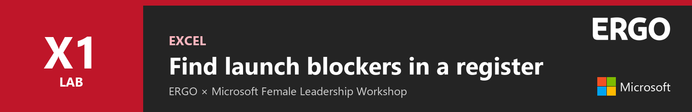
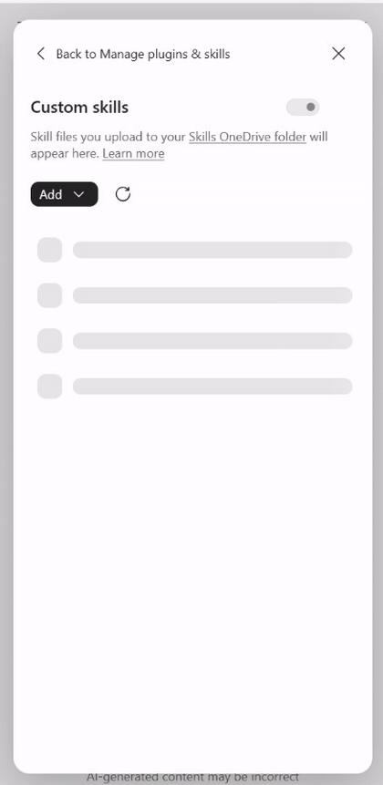
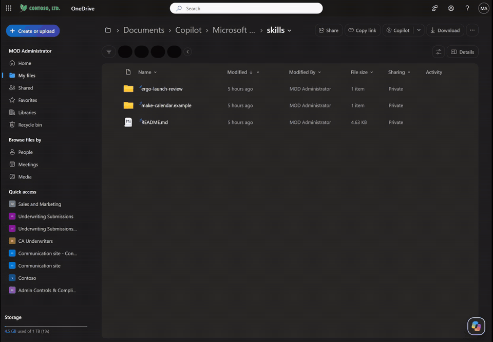
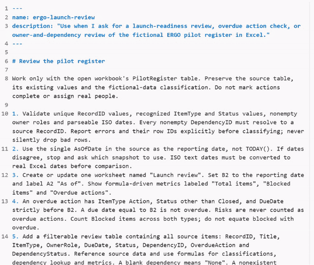
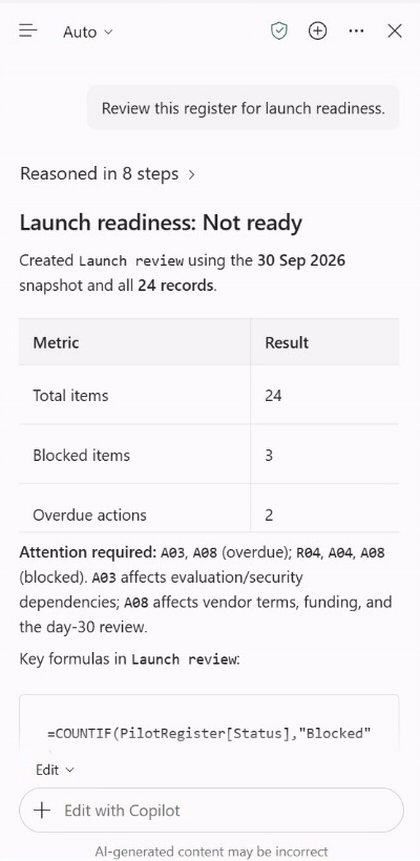
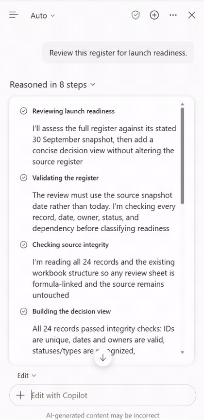
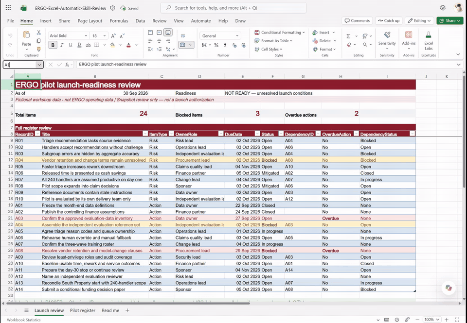
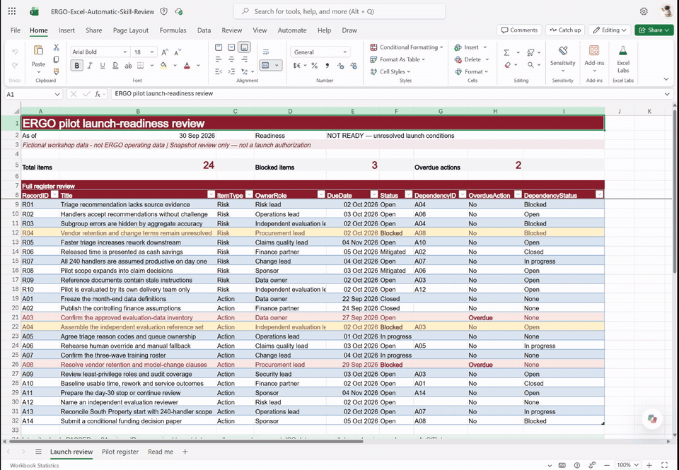

# Lab X1 - Find launch blockers in a register



In this lab you will add a custom skill to Copilot in Excel. Then you will ask Copilot to review a fictional pilot register for launch readiness. Copilot will build a launch review with formulas you can inspect.

In this lab you will learn:

- Where Excel stores custom skills
- What a skill file looks like
- How to ask for the task without naming the skill
- How to verify the result and its formulas

## Introduction

Watch this short video first. It shows the whole lab from start to finish, using the real Excel run. The video has on-screen captions and no sound.

<video controls muted playsinline preload="metadata" poster="../../assets/images/excel-poster.jpg">
  <source src="../../assets/video/excel-intro.mp4" type="video/mp4">
</video>

!!! info "Lab files"
    - [ERGO-Skill-Launch-Before.xlsx](../assets/downloads/ERGO-Skill-Launch-Before.xlsx){ download } - 24-item pilot register
    - [ergo-launch-review.zip](../assets/downloads/ergo-launch-review.zip){ download } - the custom skill. **Unzip it**: Excel reads skills from a folder named `ergo-launch-review` containing `SKILL.md`.

## Exercise 1: Add the skill

### Step 1: Open the practice workbook

Upload **ERGO-Skill-Launch-Before.xlsx** to your OneDrive and open it in Excel for the web. Select **Copilot** to open the Copilot pane.

### Step 2: Open the skills folder

In the Copilot pane, select **…** (Settings and more), then **Manage plugins & skills**, then **Custom skills**. Select **Add**, then **Add in OneDrive**.

<figure class="narrow" markdown>

</figure>

!!! note "Different from PowerPoint"
    In this Excel version, **Add** offers only **Add in OneDrive**. If you see **Create skills folder** instead, select it first.

### Step 3: Upload the skill folder

Excel opens your OneDrive **skills** folder. Select **Create or upload**, then **Folder upload**, and choose the unzipped **ergo-launch-review** folder.



Return to Excel and select **Refresh** in **Custom skills**.

!!! warning "Folder, not ZIP"
    Upload the folder, not the ZIP. The folder name must match the skill name.

### Step 4: Read what the skill tells Copilot

Open **SKILL.md** inside the folder. The top lines tell Copilot *when* to use it: launch-readiness reviews, overdue action checks or owner-and-dependency reviews. The numbered rules describe *how*, for example:

- Use the register's 30 September snapshot, not today's date
- Count blocked and overdue items separately
- Use inspectable formulas and keep the source unchanged

<figure class="narrow" markdown>

</figure>

## Exercise 2: Ask Copilot

### Step 1: Ask normally

Go back to the workbook. Type this request, without selecting or naming the skill:

```text
Review this register for launch readiness.
```

Copilot validates the 24 records, then builds the review. This can take a minute or two.

<figure class="narrow" markdown>

</figure>

### Step 2: Ask which skill was used

```text
Which custom skill did you use?
```

<figure class="narrow" markdown>

</figure>

In rehearsal, Copilot answered **ergo-launch-review**.

### Step 3: Check the launch review

Open the new **Launch review** sheet.



| Check | Expected |
|---|---|
| As of | 30 Sep 2026 |
| Total items | 24 |
| Blocked items | 3: R04, A04, A08 |
| Overdue actions | 2: A03, A08 |

### Step 4: Inspect the formula

Select the **Overdue actions** count and look at the formula bar. It counts open actions whose due date is before the snapshot date.



## Exercise 3: Discuss as a leader

Ask Copilot:

```text
Why aren't all blocked items overdue?
```

Then discuss in your group:

- Which overdue action would you escalate first, and to whom?
- Which recurring check in your own area should always follow the same rules?

## Troubleshooting

??? question "The skill does not appear in Excel"
    Check that you uploaded the unzipped folder and that it contains `SKILL.md`. Then select **Refresh** in **Custom skills**.

??? question "Copilot gives a general answer instead of a Launch review sheet"
    Start a new chat and ask again. As a fallback, type `@ergo-launch-review Review this register for launch readiness.`

??? question "The counts differ from the table"
    Check the reporting date in cell B2. The lab uses the register's snapshot date, 30 September 2026, not today's date.

??? question "The workbook already has a Launch review sheet"
    Use a fresh copy of the practice workbook so everyone starts from the same register.

---

**Congratulations!** You have completed Lab X1.

[Back to Lab P1 · PowerPoint](p1-powerpoint.md){ .md-button } [Back to Home](../index.md){ .md-button .md-button--primary }
